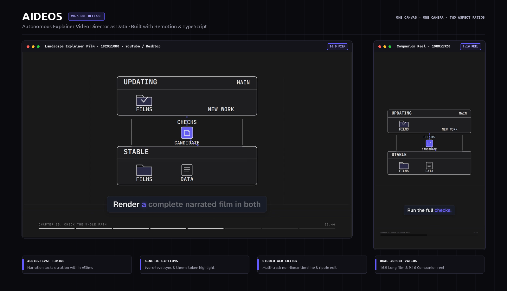

<!-- File Description: Master documentation, overview, and quick start guide for the Aideos explainer video engine. -->

# Aideos: Programmatic Explainer Video Generator as Data

Aideos turns markdown scripts into narrated explainer videos as data, rendering 16:9 landscape films and 9:16 vertical reels with Remotion and TypeScript.

[](LICENSE)
[](docs/RELEASES.md)
[](https://www.typescriptlang.org/)
[](https://www.remotion.dev/)



---

## What is Aideos?

Aideos is an autonomous explainer video engine that turns structured screenplays into complete, high-production animated videos. Rather than treating video as opaque video clips on a manual timeline, Aideos represents every explainer video as **pure, serializable data**: a continuous 2D spatial canvas, a mathematically derived camera trajectory, declarative SVG vector animations, and an audio-first timing clock.

From a single script, Aideos produces two synchronized deliverables:
1. **16:9 Landscape Film** (1920x1080 @ 30 FPS): High-resolution explainer for YouTube, desktop monitors, documentation, and technical courses.
2. **9:16 Vertical Companion Reel** (1080x1920 @ 30 FPS): Concise companion cut for mobile feeds, YouTube Shorts, TikTok, and Instagram Reels.

Both formats share the same visual canvas, scene motion, and typography, reframed cleanly with format-safe zones. Every render appends the configured like-and-subscribe end card (6 seconds for Long and 3 seconds for Reel); its copy, handle, and timing are set in `aideos.config.json`. The end card is compulsory and cannot be turned off for a film, and every video also needs music and sound effects: delivery is refused with a plain message until it has all three (see [Compulsory finishing steps](docs/WORKFLOW.md#compulsory-finishing-steps-every-video)).

---

## Why Aideos? Video as Data

Traditional video editors (Premiere, DaVinci Resolve, Final Cut Pro) are built for manual clipping and keyframing. For technical explainers, this workflow creates serious friction:
- **Timeline Drift**: If you revise a technical explanation by adding two words, every subsequent cut, title, transition, and caption on your timeline slips out of sync.
- **Dual-Format Overhead**: Reformatting a 16:9 landscape video into a 9:16 vertical reel usually requires a separate editing project, manual repositioning of graphic cards, and manual re-timing of subtitles.
- **Opaque Project Files**: Binary project files cannot be inspected by language models, diffed in Git, or validated against design rules.

Aideos solves this with **Video as Pure Data**:
- **Audio-First Timing**: Speech synthesis locks the master timeline. Every shot duration, camera move, and visual transition is pegged to the exact millisecond timestamps of the spoken narration.
- **Derived Camera Motion**: Viewport centers, zoom factors, and bounding boxes are solved from coordinates on a continuous spatial canvas. No manual panning keyframes.
- **Dual Deliverables from One Manifest**: The companion reel reframes the identical scene stage, maintaining continuity and legibility across both formats.
- **Programmatic Validation**: Every film is validated by strict schemas, pacing rules (maximum hold durations, breather intervals), and deterministic quality review rubrics before export.

---

## Who is Aideos For?

- **Technical Educators & Engineers**: Create deep-dive explainers for algorithms, distributed systems, neural networks, and cloud architectures with clean typography and technical diagrams.
- **Developer Advocates & Open Source Maintainers**: Keep documentation videos version-controlled, up to date with product releases, and reproducible directly from code.
- **Content Creators**: Produce paired widescreen YouTube explainers and mobile vertical reels from a single source of truth without double editing.
- **AI Engineers & Autonomous Workflows**: Integrate script-to-video pipelines via CLI or Model Context Protocol (MCP) server endpoints.

---

## Key Features

- **Audio-First Master Clock**: Narration is the single source of truth for time. Pluggable speech backends (offline Kokoro-82M ONNX, Google Cloud TTS, or macOS say) synthesize narration per shot. Silence trimming and sample-domain assembly guarantee that visual transitions align to speech within +-50ms.
- **Word-Level Kinetic Subtitles**: Phrase-locked captions reveal words in sync with voiceover audio, using active semantic theme tokens. Caption placement can be repositioned and locked per format in the Studio preview.
- **Aideos Studio Web Editor**: Interactive Neobrutalist web app (React 19 + Tailwind CSS + Remotion Player) running locally. Features 7 dedicated stages: Script authoring, 2D Story spatial canvas, Look styling, Motion keyframing, Non-linear multi-track Edit, Captions sync, and Review critique.
- **Non-Linear Timeline Geometry**: OpenShot-grade timeline with transaction-grouped edits, magnetic ripple editing (toggle via `R` key), sticky boundary snapping, audio waveforms, and atomic undo/redo (`Cmd + Z`).
- **Soundtrack Mixing & RMS Ducking**: Multi-track audio mixer dynamically ducks background music during spoken voiceover based on measured narration intervals. Audio assets and sound effects are cached and hash-locked (`aideos audio fetch`, `aideos audio verify`).
- **Configurable End Cards**: Automatically appends a branded like-and-subscribe card (6 seconds on Long, 3 seconds on Reel; handles and copy set in `aideos.config.json`). The end card is compulsory and cannot be turned off for a film.
- **Condensed Reel Cut Delivery**: When long-form narration exceeds the 179-second vertical delivery limit, Aideos builds a condensed narration cut with kept shots, locked phrases, and motion floors (`aideos reel brief`, `aideos reel check`, `aideos reel build`).
- **Automated Quality Review**: Deterministic video review measuring cuts, stillness, caption coverage, contrast, and layout persistence (`npm run review`), paired with optional Gemini 3.8 Flash multimodal review (`aideos gemini-review`) and automated repair loops (`aideos all-check`).
- **Local Stable & Updating Channels**: Independent local checkouts keep stable production separate from active development, as documented in [docs/RELEASES.md](docs/RELEASES.md).

---

## How It Works

```
┌─────────────────────────────────────────────────────────────────────────────┐
│ 1. SCREENPLAY INTAKE                                                        │
│ • Natural language topic -> LLM director drafts structured Claude script    │
│ • Or your own story as plain paragraphs (#Start, #Conclusion markers ok)    │
└──────────────────────────────────────┬──────────────────────────────────────┘
                                       │ Script Markdown
                                       ▼
┌─────────────────────────────────────────────────────────────────────────────┐
│ 2. AUDIO-FIRST TIMING ENGINE                                                │
│ • Synthesizes speech per segment via Kokoro-82M ONNX, Google TTS, or say    │
│ • Normalizes audio (-16 LUFS) and aligns word timestamps                    │
│ • Writes voiceover.wav, captions.vtt, and voiceover_words.json              │
└──────────────────────────────────────┬──────────────────────────────────────┘
                                       │ Master Timing Spine
                                       ▼
┌─────────────────────────────────────────────────────────────────────────────┐
│ 3. SEMANTIC VISUAL SELECTION & SPATIAL CANVAS                               │
│ • Selects visual blocks (DeviceCard, MatrixGrid, StatCounter, TokenStrip)   │
│ • Computes continuous 2D coordinates (x, y, w, h) and directed graph edges  │
│ • Derives smooth camera trajectories and enforces pacing rules              │
└──────────────────────────────────────┬──────────────────────────────────────┘
                                       │ Authoritative film.json
                                       ▼
┌─────────────────────────────────────────────────────────────────────────────┐
│ 4. REMOTION RENDER ENGINE & STUDIO                                          │
│ • Real-time interactive preview in Aideos Studio (localhost:3001)           │
│ • Headless render: 16:9 Long (1920x1080) & 9:16 Vertical Reel (1080x1920)   │
│ • Audio loudness mastering, contact sheets, and deterministic review        │
└─────────────────────────────────────────────────────────────────────────────┘
```

---

## Quick Start

### 1. Prerequisites
- **Node.js**: v20.x or higher
- **FFmpeg**: Required for audio normalization, waveform extraction, and video mastering
- **Operating System**: Linux or macOS

### 2. Installation
Clone the repository and install root and editor dependencies:
```bash
git clone https://github.com/Mani212005/aideos.git
cd aideos
npm install
```
The repository skips onnxruntime-node's Linux CUDA download because Aideos runs Kokoro on the CPU. To opt in during installation, set `npm_config_onnxruntime_node_install_cuda=true`.

### 3. Launch Aideos Studio
Start the interactive web editor:
```bash
npm run editor
```
Open [http://localhost:3001](http://localhost:3001) in your browser. The editor lets you inspect scenes, scrub the timeline, reposition captions, and review films.

### 4. Render Video Deliverables
Render the active video package to MP4:
```bash
# Render 16:9 landscape explainer film (videos/<slug>/renders/long.mp4)
npm run render

# Render 9:16 vertical companion reel (videos/<slug>/renders/reel.mp4)
npm run render:reel
```

### 5. Install the Global CLI (Optional)
To use the `aideos` command globally from any directory:
```bash
./scripts/install_aideos.sh
```
This symlinks `bin/aideos` to `~/.local/bin/aideos`. Ensure `~/.local/bin` is in your `PATH`.

### 6. Auto-Prompt a Film from a Topic
Let the autonomous director draft a screenplay, synthesize audio, layout scenes, and render both formats end to end:
```bash
aideos direct "Why attention scales quadratically in transformers" --broll --formats long,reel --final-export
```

### 7. Run Production from an Existing Screenplay
If you have written a script in `videos/<slug>/script.md`:
```bash
npm run backend -- film \
  --script-file videos/my-video/script.md \
  --title "My Video Title" \
  --slug my-video \
  --broll --formats long,reel --final-export
```

Without `--final-export`, `aideos film` and `aideos direct` stop after the `assemble` stage with a draft film you can preview in the studio.

### 8. Download Audio Assets
Populate background music and sound effects in the shared audio cache:
```bash
aideos audio fetch
aideos audio verify
```

### 9. Run Video Quality Review
Run deterministic quality checks against the Good Video rubric:
```bash
# Deterministic rubric review (checks persistence, contrast, pacing, captions)
npm run review -- my-video

# Multimodal video evaluation with Gemini 3.8 Flash (9.0+ quality bar)
aideos gemini-review videos/my-video/renders/long.mp4
```

---

## Aideos Studio Web Editor

The Aideos Studio (`editor/`) is a Neobrutalist web application built with React 19, Tailwind CSS, and `@remotion/player`:

| Stage | Name | Key Functionality |
| :--- | :--- | :--- |
| **1** | **Script** | Story-first paragraph authoring, collapsible visual notes, visible change list, per-line TTS voiceover, and terminal agent auto-prompting. |
| **2** | **Story** | Interactive 2D spatial canvas. Drag concept nodes, connect directed edges, and preview camera framing. |
| **3** | **Look** | Look planning inspection (`design/look.json`), theme customization (paper, blueprint, charcoal), and styleboards. |
| **4** | **Motion** | Custom SVG movie animation studio with declarative timeline keyframing and audio retiming. |
| **5** | **Edit** | Non-linear multi-track timeline, magnetic ripple editing, linked audio-video trimming, and movable captions. |
| **6** | **Captions** | Word-level timestamp synchronization and karaoke highlighting preview. |
| **7** | **Review** | Pacing analytics charts, AI critique drawer, and headless Remotion MP4 export. |

---

## Release Channels & Project Status

### Project Status: v0.5 Pre-Release
Aideos is currently an **early pre-release (version 0.5 planned)**. The engine, rendering pipeline, and Studio editor are fully functional and actively used, but data schemas, APIs, and CLI commands may evolve before version 1.0.0.

### Local Stable & Updating Channels
Aideos supports a dual-channel release architecture to protect valuable production projects:
- **Dev Channel (`aideos-dev`)**: Runs from your active Git checkout on branch `main` (default port 3001). This channel receives daily features, experimental flags, and fixes.
- **Stable Channel (`aideos` / `aideos-stable`)**: Runs from a separate, clean clone pinned to an approved release tag (default port 3002). Stable has its own isolated `videos/` folder and dependencies, preventing development changes from touching existing projects.

To promote a release from dev into stable, run:
```bash
npm run release -- 0.5.0 --acceptance /path/to/prepared-film
```
Promotion requires passing full CI, dual-format production, measured rubric reviews, Gemini evaluation, and an interactive human watch confirmation. See [docs/RELEASES.md](docs/RELEASES.md) for detailed setup and rollback workflows.

---

## Documentation

- [Architecture Context & Schemas](docs/CONTEXT.md): Data types, schemas (`Film`, `Shot`, `Block`), and engine reference.
- [Web Editor Architecture](docs/DESIGN.md): Studio frontend design system, timeline drag machine, and stage specifications.
- [Production Pipeline Reference](docs/PRODUCTION_PIPELINE.md): Stages from intake to render, resume behavior, and MCP tools.
- [Video Production Workflow](docs/WORKFLOW.md): Design axioms, 7-rule pacing gate, and complete CLI command table.
- [Local Release Channels](docs/RELEASES.md): Setting up stable clones, release promotion, and rollback.
- [Director Screenplay Guide](docs/DIRECTOR_GUIDE.md): Screenplay authoring rules, tags, and LLM director prompts.
- [Video Review & Rubric](docs/REVIEW.md): 12-criterion Good Video rubric, measured facts, and Gemini evaluation.
- [Audio Library & Soundtrack](docs/AUDIO_LIBRARY.md): Soundtrack mixing, dynamic music ducking, and cache verification.
- [Video Design System](src/dl/README.md): Token palettes, contrast requirements, and motion easing specs.
- [Vector Scene Engine](src/dl/scene/README.md): Declarative SVG animation clips, scene stages, and continuous camera tracks.

---

## Frequently Asked Questions

#### How does Aideos differ from traditional video editors like Premiere or DaVinci Resolve?
Traditional video editors store video as static media slices on a timeline. Aideos treats video as code and structured data: an infinite 2D canvas with continuous camera paths, declarative SVG animations, and audio-first synchronization. When you revise your script, Aideos recalculates timeline durations and subtitle alignments automatically.

#### Do I need to manually re-edit my video for vertical reels?
No. The 9:16 Vertical Reel is compiled from the same canvas, camera, and visual scene data as the 16:9 Landscape Film. If the film is under 179 seconds, it reuses the long narration directly. If longer, Aideos condenses the script to fit mobile limits while preserving key hooks, numbers, and decisive visual moments.

#### Can I run Aideos completely offline without paid API keys?
Yes. Speech synthesis defaults to Kokoro-82M ONNX, which runs locally without network access. Screenplays can be authored by hand in markdown, and rendering uses local Remotion and FFmpeg. Paid API keys (Google Gemini, Claude) are only required when using autonomous LLM director drafting or automated multimodal video reviews.

#### How does audio-first timing work when the script changes?
The synthesized narration audio track serves as the master clock for the film. Total shot durations must sum to the voiceover length within +-50ms. When dialogue changes, narration is stored per line by content fingerprint (`voiceover_lines/`) so only changed lines are re-recorded. The synthesizer updates the audio spine, measures exact word boundaries, and retimes all camera transitions and subtitle reveals accordingly.

#### Can I edit the video visually instead of editing code?
Yes. Launch `npm run editor` to open Aideos Studio. You can drag concept nodes on the 2D spatial canvas, reposition caption cards directly in the video preview, scrub and trim clips on the multi-track timeline, adjust themes, and review pacing charts in the browser.

---

## License

This project is licensed under the MIT License: see the [LICENSE](LICENSE) file for details.
