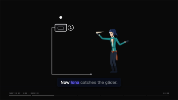
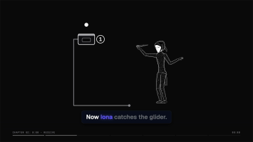
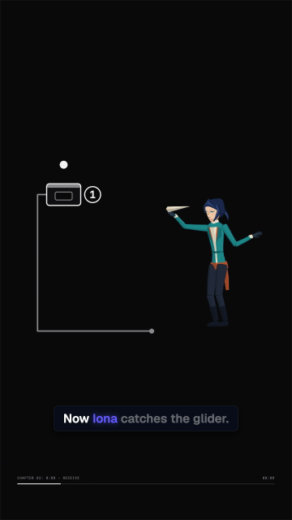
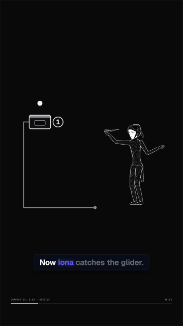

<!-- File Description: Reproducible scope, measured costs, review evidence and known gaps for the optional dots stage treatment. -->

# Optional dots treatment: evidence

The same Iona character, rig, receive action, camera, scenery and captions from
the approved `message-receipt` film were exported as cel and dots. The evidence
is a short catch excerpt, source frames 230-290 inclusive at 30 fps, with contact
at source frame 260 (clip time 1.0 s). It contains 61 picture frames, 2.0333 s.
The encoded audio/container lasts about 2.09 s. This is engineering evidence;
full-film acceptance remains a separate review.

## Readability

The reel preserves the face and catch pose reasonably well. The wide shot is
too small at 360 px for fine expression detail in either style. Dots carry less
visual weight than cel. Continuous face paint, hand outlines and prop creases
help the pose read, while the body remains visibly stippled. These are the same
absolute contact frame, downscaled with ffmpeg's area filter:

| 360 px wide | Cel | Dots |
| --- | --- | --- |
| Wide output |  |  |
| Reel output |  |  |

[Full 1920 px dot still](dots/dots-wide-1920.png).

## Cost measurement

Five runs per treatment and output format alternated cel, dots, cel, dots on
an Apple M4, 10 CPU cores. The host was shared; load averages when resuming
the last three exports were 3.23, 4.83 and 5.84. A disk-guard refusal paused
the sequence after 17 exports; firstmate freed headroom before continuation.
The pause is excluded from each render's elapsed time. Each format rendered sequentially at concurrency 2, using
Chrome with ANGLE, the ordinary H.264 CRF 16 / PNG settings, the real-frame disk preflight and the
live 3 GiB disk watchdog. No full film was rendered for this task.

The observed medians were higher for dots. This comparison does not isolate a
shader bottleneck or establish a general rendering speed difference. Timed work
includes the actual render CLI, bundling, browser/scene setup, drawing and
encoding, excluding the separate disk preflight. Startup costs matter for a
two-second excerpt. Do not extrapolate these
numbers to a full film or call them a shader benchmark.

| Output | Treatment | Render seconds: median (range), n=5 | Seconds per video second: median | Maximum observed tree RSS (MiB) | Maximum observed temp disk (MiB) | MP4 size: median (KiB) |
| --- | --- | --- | --- | --- | --- | --- |
| Wide | cel-v1 | 8.05 (7.94-8.36) | 3.96 | 2121.1 | 39.8 | 277.2 |
| Wide | dots-v1 | 9.31 (9.18-9.42) | 4.58 | 2300.5 | 42.3 | 828.3 |
| Reel | cel-v1 | 8.28 (7.72-8.41) | 4.07 | 2280.9 | 39.9 | 275.7 |
| Reel | dots-v1 | 9.98 (8.72-10.24) | 4.91 | 2286.7 | 42.3 | 826.1 |

[All 20 observations](dots/costs.csv). Every successful output was probed for
its dimensions and 61 decoded frames. RSS sums the worker process tree and can
count shared pages more than once; it is not unique resident memory. RSS and
temporary disk were sampled once a second, so the table reports observed peaks,
not guaranteed instantaneous maxima. Final MP4 bytes are measured separately.
These final-material exports and raw logs remain in `.frames/dots-evidence/final/` locally.
Earlier exports remain in its parent directory and are excluded from this table.
The one-off measurement driver there records the exact options and guard data.

## Stability and review

The raster test uses actual browser renders of Iona, Pip and Marlo. Surface
samples keep their local position and rank through pose changes; cold independent
browser workers and repeat/reverse seeks agree. A covering opaque foreground
mesh hides all character pixels, including dots, and a rear mesh leaves them
visible. Both eyes and the mouth retain at least two dark and two light pixels
in their measured 360 px character-view feature regions. This is a contrast
check, not a score for expression appeal at every delivered crop.

Twelve separately evaluated held frames are identical lossless PNGs. After
H.264 encoding at CRF 18, maximum mean channel difference from the first frame
was 0.0054 for dots and 0.0134 for cel on the 0-255 scale, both below 0.1.
These are held-pose measurements, not a motion-quality score.

Measured reviews are attached for [wide](dots/review-long.json) and
[reel](dots/review-reel.json). Both report `dots-v1` in stage truth. Both fail
captions and audio sync when the ordinary full-film reviewer receives the
full source metadata alongside this two-second excerpt: its caption words are
compared with source time zero, and its 51.15 s spine is compared with 2.03 s
of picture. Non-gating plan adherence also flags source camera poses outside
the excerpt. These reports are preserved as failures, without changing the
rubric or claiming that the full film passed.

The committed review copies replace local absolute paths with repository-relative
artifact paths. The original local review artifacts are unchanged.

One [Gemini 3.8 Flash review through agy](dots/gemini-review.json), explicitly
briefed on the excerpt and source-time offset, returned REVISE at 8.8 with all
six hard gates passing. It marked storyline and pacing down because a two-second
excerpt cannot satisfy the full-film rubric. This is supporting evidence only:
the excerpt has not met the 9.0 full-film acceptance bar, and this result does
not override the measured failures. Requests to inspect the later unfolding
message record and review all seven beats were skipped under the task's short-clip
scope. The unfolding record is SVG scenery, outside the dot treatment.

The reviewer also suggested tighter dot pitch for facial closeups and called
the face/jacket stippling slightly coarse at small sizes. The face already uses
continuous monochrome paint, with no dots over its eyes or mouth. Jacket tuning
remains a visual limitation to judge in the supplied phone stills; the contrast
test does not establish that its visual weight matches cel.

## Verification

The initial full-suite attempt had 983 passing unit tests, one dots raster
browser timeout, and three optional skips. After the timeout fix, the configured
Test command passed: 984 unit tests passed with zero failures and three expected
optional skips; all 29 browser journeys passed without TODOs. Studio smoke and
scrub, fixture, evaluation and performance checks also passed. The live journey
covered Iona in dots and a second character in cel in the same scene through
Player and export, in wide and reel crops. Lint remains a separate outer-run
phase and is not claimed here. The Iona legacy/spec pixel comparison and the
Pip/Marlo committed cel stage still comparisons passed in both crops. The Linux
legacy golden step was skipped by its platform guard, as recorded below.

Cel's frozen resource identity is unchanged
(`b93363ca740717e87af00bb1c2bbe0d4ecd7f6bc83a1639784e4000232219469`).
The measured dots sources are frozen separately at
`a82c3c49051de749fcccca2f81f55669a3243e18bc911a859d93317e69852230`.
New tests cover sampling/pose
attachment, field-path validation, resource integrity, attributable dot pixels,
face/occlusion/encoded holds, and J3/J4 real Player/export equality, mixed
cel/dots shot seeking and both output crops.

## Known gaps

- The separate `iona-receive` cost comparison was dropped by firstmate after
  two audio 404s. Its committed fixture references a WAV it does not include;
  benchmarking it requires tone synthesis through `runProduction`. The 20
  successful approved-film catch exports provide this task's cost evidence.
- A full dots film, later SVG transitions and a new captain watch were outside
  the authorized short-render scope. The model's later-shot requests remain
  unmeasured here; its final 8.8 REVISE is retained, not called acceptance.
- Fine expression detail in the wide output at 360 px and the dots' lower visual
  weight/coarse jacket texture remain visible limitations, as shown above.
- The existing legacy golden harness runs only on Linux. A macOS invocation
  skips its pixel comparison; Linux CI must supply that platform's verdict.
