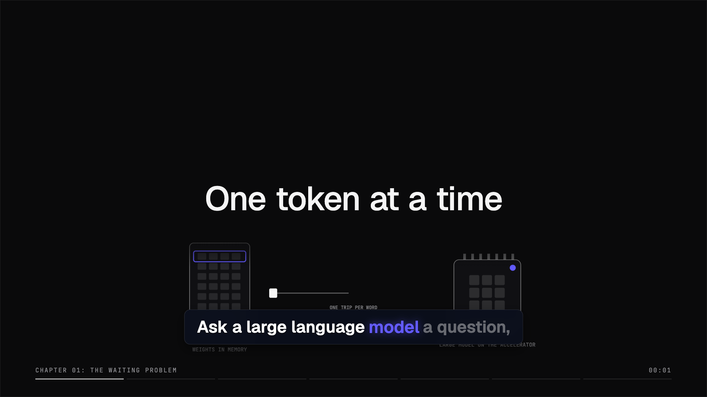
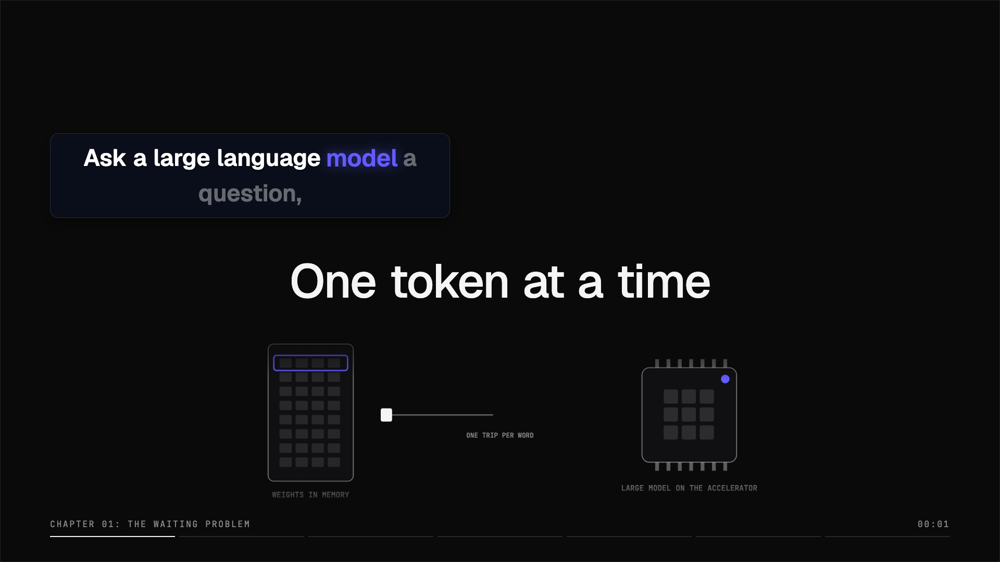
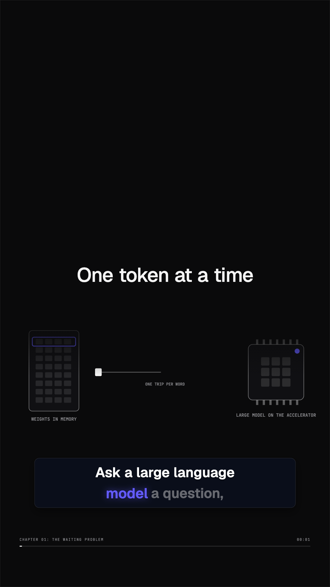
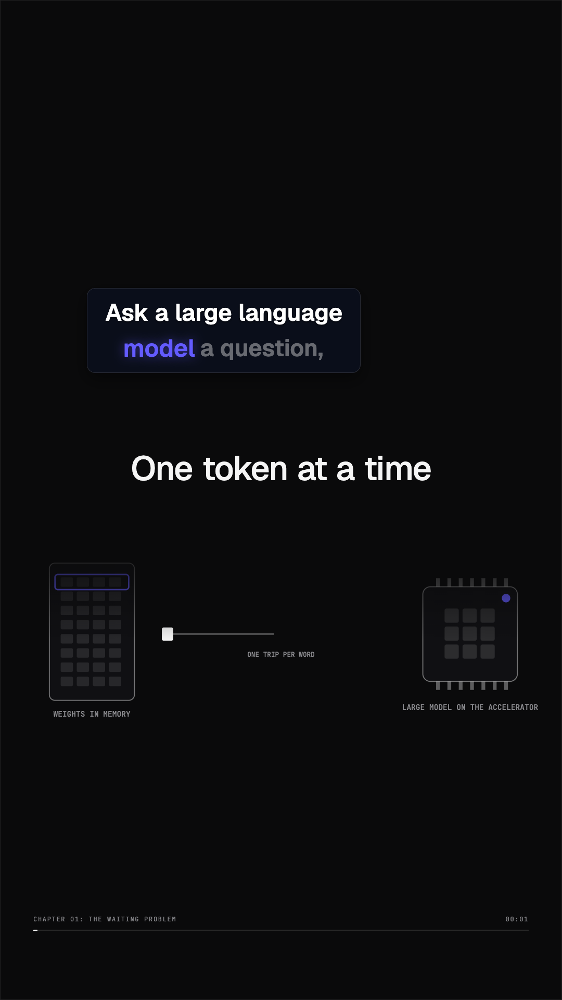

# Movable caption proof

Real film `speculative-decoding-designed`, frame 45. The after images use saved positions
that are locked. Font size is unchanged. These images are for visual
acceptance by the owner.

The saved Wide card is `{x: 0.42637305699481864, y: 0.2367681347150259, w: 0.7527461139896373}`;
the Reel card is `{x: 0.3983630781040107, y: 0.28778821243523317, w: 0.63524467472654}`.
Both are locked with explicit widths. Placements without `w` retain the legacy content-sized card,
including after first save; the editor and collision checks reserve the full 86% band. Explicit
resizes save a fixed width within the format bounds.

| Format | Before | Moved and resized |
| --- | --- | --- |
| Wide |  |  |
| Reel |  |  |

Eight default-film stills across four fixture films and both formats matched their references
with zero differing pixels. J13 verifies both scopes, move, resize, lock, reset, undo and reload,
then checks native Player caption ink bounds against PNG and MP4 export within 2 px.
The journey also compares the visible card, drag outline and collision rectangle at saved
width 86% and after resizing. Unit CI passed 1,017 tests with 3 skipped; static CI, J3 and
studio smoke passed.

For CanvasGraph films, the design report explicitly says placed-card collisions against graph art
were not checked because the graph uses 3D projection. Manually review the placed card against the
visible graph; scene-art and posed-character collision checks remain active.

The original fixture narration is unavailable. Separate 10-second MP4 excerpts used disposable
tone audio, which is not committed. Measured review passes the placed-caption gate in both
formats (Wide 60%, Reel 80% coverage, no over-two-line frames), but fails overall because the
10-second excerpt is compared with the full 188-second film, plus Reel small-label readability.
Gemini CLI returns REVISE for both: its deterministic placed-card caption
gate reports 67% coverage in both formats, below its threshold. Tone audio and truncated storyline also
limit those reviews. These are placement measurements, not quality-approved films.

Review thresholds are unchanged. Calibration could not run without the external
`AIDEOS_CALIBRATION_A`, `AIDEOS_CALIBRATION_B` and `AIDEOS_CALIBRATION_RAG` reference paths.

No-mistakes risk level: High, covering schema, rendering, owner persistence, gestures, review
and checked AI editing. Automatic placement, suggestions, CTA and reel-length changes remain
outside this change.
